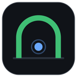

# app-releases

**Download page and update feed for Neil's own apps.** Every app of ours that can update itself publishes here: this is
where the apps look for a new version, and where you pick up a first install. Public, built apps only (APKs, Windows
programs); the source stays in private repos and nothing binary is committed (builds are
[GitHub Release](https://github.com/neil-bh/app-releases/releases) assets).

<!-- index:start (tools/publish writes this table) -->
| App | Latest |
|:-:|---|
| <a href="apps/claude-control-android/README.md"></a><br>**[Claude Control for Android](apps/claude-control-android/README.md)**<br>Android 10+ | Claude Control on your Android phone: your sessions, usage, widgets and approvals, and Claude Control in Android Auto.<br><br>**1.13.3** · 2026-11-27<br>[Download .apk](https://github.com/neil-bh/app-releases/releases/download/claude-control-android-v1.13.3/ClaudeControlAndroid-1.13.3.apk) (4.3 MB) · [What's new](apps/claude-control-android/CHANGELOG.json) |
| <a href="apps/claude-control-windows/README.md"></a><br>**[Claude Control for Windows](apps/claude-control-windows/README.md)**<br>Windows 10/11 (64-bit) | Claude Control in a window of its own, with your Claude usage in the Windows notification area.<br><br>**1.7.10** · 2026-11-27<br>[Download .exe](https://github.com/neil-bh/app-releases/releases/download/claude-control-windows-v1.7.10/ClaudeControl-1.7.10.exe) (13.5 MB) · [What's new](apps/claude-control-windows/CHANGELOG.json) |
| <a href="apps/family-game-night/README.md"></a><br>**[Family Game Night](apps/family-game-night/README.md)**<br>Android (arm64) | A party phrase game for the family: test builds for Android.<br><br>**465260** · 2026-11-20<br>[Download .apk](https://github.com/neil-bh/app-releases/releases/download/family-game-night-v465260/FamilyGameNight-465260.apk) (25.7 MB) · [What's new](apps/family-game-night/CHANGELOG.json) |
| <a href="apps/rbv-control/README.md"></a><br>**[RBV Control](apps/rbv-control/README.md)**<br>Windows 10/11 (64-bit) | Remote Browser View: lets Claude on the Dell see and drive a browser on the laptop, with the owner's permission.<br><br>**1.4.0** · 2026-11-18<br>[Download .exe](https://github.com/neil-bh/app-releases/releases/download/rbv-control-v1.4.0/RBVControl-1.4.0.exe) (12.9 MB) · [What's new](apps/rbv-control/CHANGELOG.json) |
| <a href="apps/tunnel-control/README.md"></a><br>**[Tunnel Control](apps/tunnel-control/README.md)**<br>Windows 10/11 (64-bit) | Keeps the SSH forwards from a Windows PC to the Dell up (Rojo, Studio MCP and friends), from the notification area.<br><br>**1.8.0** · 2026-11-18<br>[Download .exe](https://github.com/neil-bh/app-releases/releases/download/tunnel-control-v1.8.0/TunnelControl-1.8.0.exe) (12.5 MB) · [What's new](apps/tunnel-control/CHANGELOG.json) |
<!-- index:end -->

*Click an app's name for what it does, how to install it and its full release notes. Each download is checked by the app
itself (size and SHA-256) before it installs; the fingerprint is on the app's page if you want to check it by hand.*

## Install and update

| Platform | First install | After that |
|---|---|---|
| **Windows** | Download the `.exe` from the table, run it. | The app checks here itself and offers the update. |
| **Android** | Download the `.apk` on the phone, open it, allow your browser to install apps when asked. | The app checks here itself and hands the new APK to Android's installer (Android asks you to confirm). |

All the apps read `https://raw.githubusercontent.com/neil-bh/app-releases/main/apps/<app-id>/latest.json`, and fall back
to their old source (the Dell, over Tailscale) only when GitHub cannot be reached. How it works, the `latest.json`
format and the rules for publishing: [docs/RELEASES.md](docs/RELEASES.md).

## What is in here

```
apps/<app-id>/   app.json · logo.png · README.md · CHANGELOG.json · latest.json   (one folder per app)
docs/RELEASES.md the contract: layout, latest.json, how an app checks, how to publish
tools/           publish · check · test   (Python, standard library only)
```

## Publishing (from the Dell, by the owner)

```
tools/publish <app-id> <version> <file> --changelog <the app's CHANGELOG.json> --notes-from-changelog   # --dry-run first
tools/check     # validates every app folder and this table
tools/test      # tests the tools
```

`tools/publish` secret-scans the file, creates the release, writes `latest.json`, the app's "Latest" line and the table
above. **Adding an app:** a folder `apps/<app-id>/` with `app.json`, `CHANGELOG.json`, a `README.md` and a 128 px
`logo.png`, then publish its first release.
